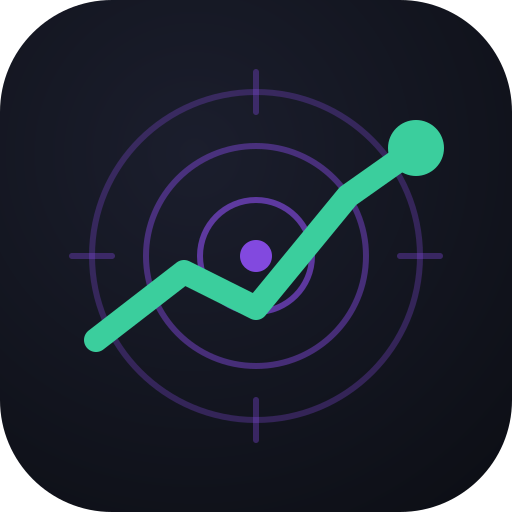

<p align="center"></p>

<p align="center"><b>English</b> · <a href="README.zh-CN.md">简体中文</a></p>

# Stock Compass for AI apps

Use your [Stock Compass](https://stock-compass.app) records from any AI app or agent. You can ask about your watchlist, holdings, signals, trades and journal; have it record a trade, change a stop or target, or set a price alert; or get help writing and backtesting a strategy. It covers Hong Kong, US and China A-shares.

**It only keeps records.** Recording a trade writes it into your Stock Compass journal. It never places an order with a broker. Connecting needs a Stock Compass **Pro** account.

## Let your AI set it up

Paste this into your AI app (Claude, ChatGPT, Claude Code, Cursor or any other):

```text
Set me up with Stock Compass: open https://stock-compass.app/ai/setup.md and follow it step by step to install it, sign me up and get me started.
```

The AI reads the [setup guide](https://stock-compass.app/ai/setup.md) and walks you through connecting your app. If you have no account yet, it also helps you sign up; new accounts get a free Pro trial with no card. You sign in on stock-compass.app itself and never give the AI your password. To do it by hand instead, see [Connect your AI app](#connect-your-ai-app).

## What is in this repository

| | What it does | Works with |
| --- | --- | --- |
| **MCP connector** at `https://stock-compass.app/api/mcp` | Gives an AI 9 tools on your own records: 4 that read and 5 that write | Any app that supports remote MCP servers: Claude, ChatGPT, Claude Code, Cursor and others |
| **Skill**, `skills/stock-compass/` | Teaches an AI how all of Stock Compass works and the rules for using it. It covers signals, strategies and every indicator, backtests, trades, fees, the journal, execution discipline, sizing, alerts, emails, plans, API keys and the REST API. | Apps that load Agent Skills (`SKILL.md`). For other apps, the files can be read as plain documentation. |
| **Claude plugin**, `.claude-plugin/` | Installs the connector and the skill in one step | Claude (web, desktop app, Cowork) and Claude Code |

The skill is three reference files plus `SKILL.md`. An AI reads a file only when the question needs it:

- [`SKILL.md`](skills/stock-compass/SKILL.md): when to use the tools, and the rules (confirm before any change, no advice);
- [`product.md`](skills/stock-compass/references/product.md): every page, plan, email and setting;
- [`strategies.md`](skills/stock-compass/references/strategies.md): rules, all 96 indicators, strategy JSON import, backtests;
- [`api.md`](skills/stock-compass/references/api.md): OAuth, API keys, MCP tools, REST endpoints and errors.

## Connect your AI app

| App | How |
| --- | --- |
| **Claude** (web, desktop app, Cowork) | Customize → Plugins → Add → Add marketplace → `Stock-Compass/stock-compass-plugin`. Install **Stock Compass**, then connect it on the plugin's **Connectors** tab. |
| **Claude Code** | `claude plugin install stock-compass --marketplace Stock-Compass/stock-compass-plugin`, then `/mcp` to sign in. |
| **ChatGPT** | [chatgpt.com/plugins](https://chatgpt.com/plugins) → + → Add custom MCP server. Paste `https://stock-compass.app/api/mcp` and choose OAuth. |
| **Any other MCP client** | Add `https://stock-compass.app/api/mcp` as a remote MCP server (Streamable HTTP) with OAuth, or with the header `Authorization: Bearer sc_…` and an API key. |
| **Scripts, or tools without MCP** | Use the REST API at `https://stock-compass.app/api/v1` with an API key. See [api.md](skills/stock-compass/references/api.md). |

Each app sends you to stock-compass.app to sign in and approve it:

- **Read only** (the default): your watchlist, holdings, trades, signals and price alerts.
- **Read and make changes**: also add or remove watchlist stocks, record trades, change stops and targets, and set price alerts.

You can disconnect, or revoke an API key, at any time under **Settings → AI apps & API** on stock-compass.app.

## Add the skill to your AI

- **Claude**: the plugin above includes it.
- **Apps that load Agent Skills**: copy the `skills/stock-compass` folder into the app's skills folder. Each app documents its own location.
- **Any other AI**: give it the files above, or point it at [stock-compass.app/llms.txt](https://stock-compass.app/llms.txt) for a short summary.

## Things to ask

- "What's on my Hong Kong watchlist, and what are my stops?"
- "Which buy signals did my strategies record this week?"
- "I bought 200 shares of 700 at 382.4 today. Record it, stop at 350."
- "Help me write a breakout strategy with an 8% stop and import it."
- "Why did my backtest say PARTIAL?"
- "What does 'cost of waiting' on my journal page mean?"

## Data

When you use it, the AI reads the records it needs from your account and sends Stock Compass only the changes you approve. What it reads becomes part of your conversation with that AI, under its provider's privacy terms. Stock Compass stores your sign-in only as a hashed token or key, and logs every change made through a connection; you can see the log in Settings. See the [privacy policy](https://stock-compass.app/en/privacy).

## Support

Email support@stock-compass.app or [open an issue](https://github.com/Stock-Compass/stock-compass-plugin/issues).

## License

[MIT](LICENSE)
